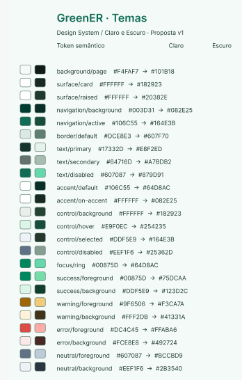
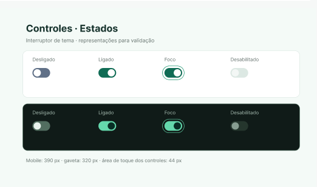
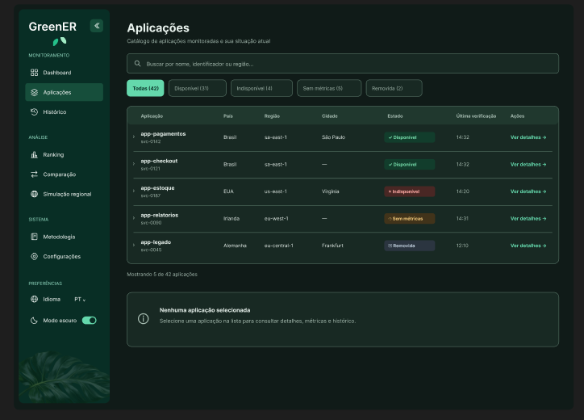
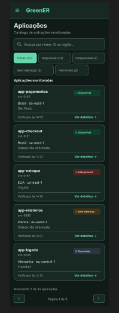

# US-17 — Temas claro e escuro no Figma

Registro de design relacionado à [issue #213](https://github.com/Seliganessecodigo/ABP-3DSM/issues/213), parte da [US-17 #209](https://github.com/Seliganessecodigo/ABP-3DSM/issues/209). A implementação da fundação de temas pertence à [task #214](https://github.com/Seliganessecodigo/ABP-3DSM/issues/214).

## Referência

[Abrir o arquivo GreenER no Figma](https://www.figma.com/design/bbt97My6jOZpJVYxbOc9T2/GreenER?node-id=0-1&p=f&t=gQPP7hhmNUF0A33e-0).

Usar a biblioteca existente `28:336` como referência, conforme a issue. A #213 mantém a propriedade de tokens, modos e seletor; a #260 consolida variantes/estados e a #261 implementa ações/feedback.

## Entrega apresentada

- Tabela de tokens semânticos com valores para os temas claro e escuro: fundos, superfícies, navegação, bordas, textos, destaques, controles, foco e feedback.
- Interruptor de tema representado nos estados desligado, ligado, foco e desabilitado nos dois temas.
- Aplicação do tema escuro ao catálogo de aplicações em desktop e mobile, incluindo navegação, busca, filtros, lista e paginação mobile.
- Estados de aplicações com texto e símbolos, além das cores: disponível, indisponível, sem métricas e removida.

Os dados das telas são exemplos do protótipo, sem validação de métricas reais ou contratos de API. O conteúdo do catálogo serve como demonstração do tema; esta PR não altera o escopo de design desse fluxo.

## Evidências visuais

### Tokens dos temas claro e escuro

A captura apresenta a proposta v1 de tokens semânticos nos dois temas. Inclui `background/page`, superfícies, navegação, bordas, textos, `accent`, controles, `focus/ring` e pares de primeiro plano/fundo para sucesso, aviso, erro e estado neutro. Por exemplo, `background/page` apresenta `#F4FAF7` no claro e `#101B18` no escuro; `text/primary` apresenta `#17332D` e `#E8F2ED`, respectivamente.

### Estados do controle de tema

O interruptor aparece desligado, ligado, com foco e desabilitado em superfícies claras e escuras. A anotação da captura registra referência mobile de 390 px, gaveta de 320 px e área de toque dos controles de 44 px. Esses valores são especificações visuais do protótipo, não medições de uma implementação.

### Aplicação do tema escuro em desktop

O catálogo mostra sidebar expandida, busca, filtros e tabela de aplicações com estados textuais e símbolos. O controle de modo escuro aparece ligado na navegação. Há também um painel informativo sem aplicação selecionada.

### Aplicação do tema escuro em mobile

A navegação global é apresentada em uma barra superior com acionador de menu. Busca e filtros antecedem os cartões das aplicações; os estados permanecem identificados por texto e símbolos, e há paginação ao final.

## Critérios para conferência do handoff

| Critério da issue | Evidência e limite da revisão |
| --- | --- |
| Tokens para os dois temas | A tabela mostra superfície, texto, borda, foco, controles e estados com valores claro/escuro. Conferir vínculos à biblioteca e links dos tokens finais no Figma. |
| Modos e seletor | Há representações ligado/desligado, foco e desabilitado nos dois temas. Opção sistema e preferência local ainda exigem conferência no handoff. |
| Aplicação compartilhada | Catálogo e navegação global demonstrados no tema escuro em desktop/mobile. Conferir aplicação completa do claro e reutilização no detalhe operacional. |
| Estados compreensíveis | Estados do catálogo escuro usam texto e símbolos além da cor. Conferir o mesmo tratamento nas demais telas e no tema claro. |
| Acessibilidade e responsividade | Há representação de foco, referência de área de toque e catálogo mobile. Contraste medido, teclado e textos longos dos oito idiomas ainda exigem validação. |
| Revisão | O link do arquivo está registrado. Conferir links específicos dos tokens/frames finais e registrar revisão/aceite do PO na issue. |

O arquivo Figma não pôde ser inspecionado pelas ferramentas desta sessão. A revisão visual se baseia nas quatro capturas originais; propriedades internas, vínculos de variáveis, interações e homologação não são comprovados pelas imagens. A política de persistência e o comportamento da opção sistema não são definidos por inferência visual.

## Escopo e limites

- Registrar o design de temas e seu handoff para #214.
- Manter tokens, modos e seletor alinhados à biblioteca existente, sem criar uma biblioteca genérica ou redesenhar outras telas.
- Conferir os critérios no Figma e nas evidências antes de declarar validação; imagens estáticas não comprovam sozinhas teclado, persistência ou resposta à preferência do sistema.
- Registrar pendências e revisão do PO na #213. A abertura da PR não encerra a issue nem representa homologação.

## Verificações e revisão

- As quatro imagens originais foram conferidas visualmente, mantendo os nomes fornecidos pelo autor.
- Conferir no Figma a opção sistema, a preferência local, os vínculos de tokens e a aplicação do padrão no catálogo, detalhe operacional e layout global.
- Validar contraste, teclado, foco e textos longos dos oito idiomas e registrar o aceite do PO na #213.
- Executar `git diff --cached --check` antes do commit e conferir os links locais e publicados.
- Conferir os checks obrigatórios para `develop`, incluindo **SonarQube Cloud quality gate**, conforme [quality-gates.md](../../quality-gates.md).
- Lint, build e testes locais de frontend/backend não se aplicam ao registro exclusivamente documental, sem alteração de código executável; declarar na PR que não foram executados.
- Este registro está em `.github/`, fora das páginas publicadas em `docs/`; não requer traduções do site nem `npm run docs:build` por si só.
