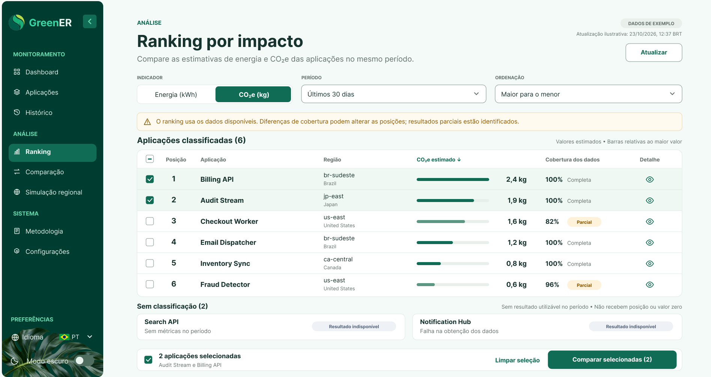
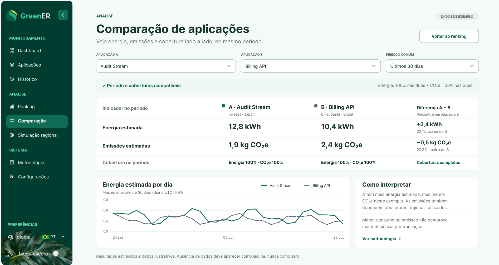
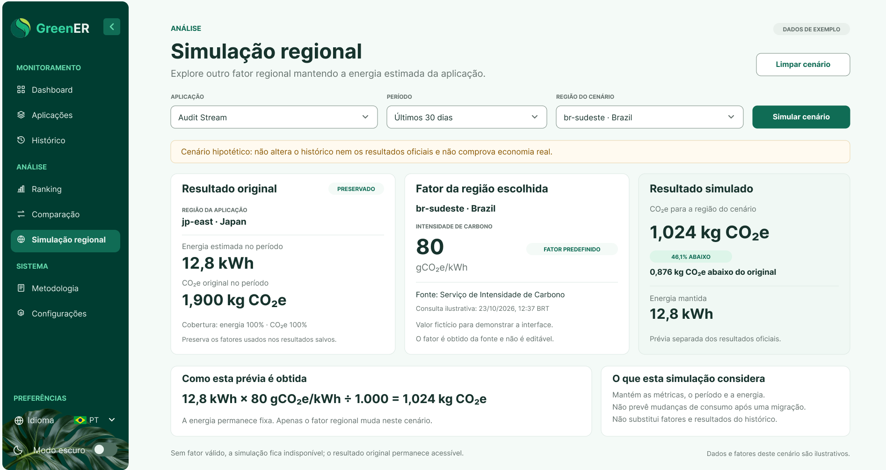

# Design — ranking, comparação e simulação regional

Refs #251, #252 e #253. Entrega documental baseada nas evidências locais existentes, no formato das PRs de design #323, #324 e #325 de Guilherme Oliveira (`guioliv3`): imagens versionadas, links dos frames, decisões e limites do handoff.

## Entrega e rastreabilidade

| Task | Evidências | Implementação |
| --- | --- | --- |
| [#251 — ranking](issue-251/README.md) | Desktop por energia/CO₂e, tablet, mobile 320, estados e diálogos; quatro propostas SVG locais | #74 / US #19 |
| [#252 — comparação](issue-252/README.md) | Desktop, tablet, mobile 320/390, carregamento/vazio/erro, seleção, limite e cobertura | #78 / US #20 |
| [#253 — simulação](issue-253/README.md) | Desktop, tablet, mobile 320/390, carregamento/vazio/erro, seleção, destino, fator e limpeza | #85 / US #22 |

O conjunto contém **36 PNGs nativos** do diagnóstico local capturado em **13/11/2026 às 17:36 UTC** e **quatro SVGs locais candidatos à correção**. O [manifesto](manifest.json) relaciona origem, arquivo, nó, dimensões e SHA-256. Os nomes numéricos dos PNGs correspondem aos IDs reais dos nós. Não há implementação frontend nesta entrega.

O diagnóstico preservado identifica quatro quadros vazios no ranking: `802:4408` (erro), `802:4427` (vazio), `802:4543` (ordenação) e `802:4650` (mobile 390). Seus PNGs vazios foram excluídos. Os SVGs `proposta-local-*` preservam a proposta visual corrigida localmente, sem afirmar que a correção foi aplicada no Figma. Arquivos auxiliares de automação, credenciais e o relatório completo do ambiente não integram a entrega.

### Prévia dos fluxos

## Handoff de interação

As regras abaixo consolidam o aceite das tasks e o handoff local. São especificações para revisão; desenhos de estados não comprovam interações navegáveis implementadas.

| Fluxo / ação | Resultado esperado |
| --- | --- |
| Ranking: escolher indicador, direção e período | Classificar pelo valor do indicador no mesmo recorte; empates recebem posições equivalentes e apresentação estável por identidade. Menor consumo absoluto não comprova eficiência. |
| Ranking: abrir item sem classificação | Informar o motivo e permitir acessar detalhe/histórico; ausência ou falha não recebe valor zero nem posição. |
| Ranking: participação | Usar total válido do mesmo indicador/recorte com denominador positivo; barra relativa ao maior valor não significa participação no total. O frame final dessa participação ainda precisa ser demonstrado. |
| Ranking: comparar selecionadas | Abrir comparação com 2–5 identidades únicas, preservando seleção entre páginas e filtros. |
| Comparação: selecionar aplicações | Impedir duplicatas e explicar limite de 2–5; escolher referência explícita. Os quadros de sucesso mostram duas aplicações; o resultado com 3–5 ainda precisa de frame final. |
| Comparação: aplicar recorte | Exibir indicadores/unidades lado a lado no mesmo período e filtros; coberturas de energia e CO₂e separadas. Diferença absoluta contra referência; percentual não aplicável para referência zero ou dado ausente. |
| Comparação: resultado parcial | Mostrar cobertura e motivos de incompatibilidade/ausência; não inferir eficiência, transações ou trabalho produzido. Não incluir kWh por transação. |
| Simulação: selecionar aplicação, período e destino | Acionar “Simular cenário”; preservar energia observada e resultado histórico, substituindo apenas o fator regional do cenário. Não garantir migração ou economia real. |
| Simulação: consultar resultado | Apresentar original, cenário, diferença absoluta/percentual quando aplicável, fator/unidade, origem e horário de consulta. Horário consultado não comprova vigência. |
| Simulação: alterar parâmetros após resultado | Identificar resultado anterior como pendente e exigir nova simulação. Sem energia/fator utilizável, explicar indisponibilidade sem fabricar zero. |
| Simulação: limpar cenário | Abrir confirmação; cancelar preserva cenário; confirmar retorna ao estado inicial sem alterar histórico oficial. |
| Todos: carregamento inicial | Anunciar progresso sem antecipar valores; manter ação de cancelar quando disponível no fluxo. |
| Todos: vazio / nenhum resultado | Diferenciar ausência de dados de filtros sem correspondência; oferecer alteração de critérios/limpeza adequada. |
| Todos: erro / tentar novamente | Explicar falha e repetir com contexto preservado. Falha na atualização mantém dados anteriores, horário e aviso explícito. |
| Todos: abrir / fechar diálogo | Foco inicial no título/campo, contenção de foco; Escape/Cancelar fecha e devolve foco ao disparador. Confirmar aplica critérios válidos. |

### Busca, filtros, ordenação e paginação

Aplicar à lista de ranking e à lista de seleção de aplicações. A matriz de indicadores da comparação e os cards da simulação mantêm a sua estrutura própria.

| Coluna de dados | Tipo / filtro | Ordenação |
| --- | --- | --- |
| Aplicação / identificador | Texto livre | Locale, crescente/decrescente |
| Localização: código regional, país, região e cidade quando exibida | Texto livre; ausência explícita para cidade nula | Locale, crescente/decrescente |
| Energia estimada | Número, mínimo/máximo em kWh | Valor numérico |
| CO₂e estimado | Número, mínimo/máximo em kg CO₂e | Valor numérico |
| Cobertura de energia / CO₂e | Número, mínimo/máximo em %; separar indicadores | Valor numérico |
| Estado / resultado e motivo | Enum do contrato com select; motivo aberto usa texto; ausência explícita | Sem ordem semântica aprovada; não inventar prioridade |
| Posição do ranking | Número derivado do indicador; filtro mínimo/máximo quando exposto | Derivada do indicador/direção; não recalcular pela página |
| Participação, quando disponível | Número, mínimo/máximo em % | Valor numérico; denominador válido |
| Datas/horários, quando exibidos na lista | Início/fim com fuso identificado | Instante |
| Seleção, ações, ícones e barras decorativas | Controles, não dados filtráveis | Não ordenáveis |

- Busca geral por trecho em todas as colunas de dados exibidas do conjunto autorizado, com caixa/acentos ignorados: `sao` encontra `São Paulo`. Não pesquisar segredos, dados ocultos nem marcadores de ausência.
- Busca geral usa OU entre colunas; filtros específicos combinam por E. Mostrar critérios ativos, limpar por coluna ou todos, preservando a ordenação.
- Uma coluna ordenável ativa por vez, nas duas direções; ausentes ao final em ambas e desempate por identidade estável. Indicar direção por texto/ícone e `aria-sort`. No ranking, ordem inicial ilustrada: CO₂e decrescente; posição acompanha o indicador, mesmo ao ordenar a apresentação por outra coluna.
- Filtrar e ordenar antes de paginar; mudança dos critérios retorna à primeira página. Preservar contexto na URL, recarga, voltar/avançar, retry e retorno do detalhe.
- Padrão **10**, opções **5, 10, 15, 20 e Todos**. “Todos” abrange o conjunto filtrado completo. Preservar tamanho/página na URL; tamanho ausente/inválido usa 10. Troca de tamanho retorna à primeira página.
- Exibir intervalo/total filtrado, página atual e navegação anterior/próxima e para uma página; desabilitar limites. Não completar com linhas vazias. Zero resultados tem mensagem própria; atualização que invalida página ajusta para a última válida. “Todos” tem uma página.
- Na comparação, paginar somente a lista de seleção; conservar escolhidas e indicadores fora da página. No ranking, não reduzir totais, participação ou gráficos silenciosamente à página visível.
- Com paginação no servidor, busca/filtros/ordenação e “Todos” exigem contrato da API sobre todo o conjunto autorizado. Parâmetros e limites não são definidos por estes desenhos.

### Responsividade, acessibilidade e temas

- Desktop apresenta tabela/matriz; mobile empilha cards com identidade, unidade, cobertura e ações visíveis. Tablet e mobile 320/390 estão identificados nos índices. Não presumir que exportar diferentes larguras valida o redimensionamento nativo.
- Ordem de foco: navegação → seletores → busca/filtros → linhas/seleções → paginação → ação principal. Tab/Shift+Tab percorrem controles; Enter/Espaço ativam botões; setas seguem o padrão do componente de seleção. Alvos de toque pretendidos: 44 px.
- Progresso e sucesso usam anúncio de status; erros usam mensagem acessível associada ao campo/ação. Cor tem rótulo/ícone correspondente. Gráficos precisam de alternativa textual e identificação de séries além da cor.
- Reutilizar tokens/temas #213, componentes #260 e período #262. Ligação nativa às variáveis e instâncias compartilhadas ainda precisa ser conferida; os SVGs importados não comprovam essas ligações nem auto-layout.
- Textos longos devem quebrar linhas e aumentar altura sem perder dados essenciais. Validar os oito idiomas exigidos pelas tasks, claro/escuro, contraste medido, teclado e leitor de tela. Estas evidências não demonstram essa validação.

## Pendências para concluir as tasks

| Pendência | Evidência necessária para aceite |
| --- | --- |
| Recuperar os quatro quadros vazios do ranking e organizar o canvas | Nova inspeção/exportação nativa após corrigir hierarquia, recorte e posições; não basta o SVG local |
| Protótipo navegável dos três fluxos | Ações/transições conectadas e verificadas no arquivo, incluindo abrir/fechar diálogos, confirmar, cancelar, retry e retorno |
| Estados parciais e limites | Frames finais de parcial, falha de atualização, referência zero, ausência/invalidade de fator/energia e edição pendente; hoje são especificações de handoff |
| Ranking completo | Participação, empates equivalentes, busca/filtros ativos e exceções de ordenação demonstrados na revisão final |
| Comparação completa | Resultado para 3–5 aplicações e seleção persistida durante busca/paginação; referência explícita e percentual não aplicável |
| Temas, tokens, acessibilidade e i18n | Claro/escuro dos fluxos, vínculos compartilhados, contraste, foco/teclado, leitor de tela e textos longos nos oito idiomas |
| Contratos e decisões de produto | Confirmar inclusão de parciais no ranking, comparabilidade, validade/frescor do fator e contratos de busca/filtros/paginação com as tasks de implementação; sem inventar endpoints ou políticas |
| Revisão do PO | Registrar feedback, alterações decorrentes e aceite nas issues; não há registro de homologação nesta entrega |

As referências iniciais `8:306`, `8:396` e `8:469` são históricas. A leitura disponível de `8:396` ainda contém “Comparação e eficiência” e kWh por 1.000 transações; esse conteúdo diverge do escopo atual da #252 e **não orienta a implementação**. A captura posterior `623:1603` apresenta energia, CO₂e e cobertura. A nova inspeção dos demais quadros e as exportações foram bloqueadas pela cota do conector em 16/11/2026.

## Verificações desta entrega

- Issues, PRs de referência, `AGENTS.md` e `.github/quality-gates.md` consultados. Branch criada de `origin/develop`; PR destinada a `develop`.
- 36 PNGs conferidos por assinatura, CRC de todos os chunks e descompressão; quatro SVGs com XML válido. Hashes e dimensões registrados no manifesto.
- Revisão visual das capturas principais de ranking, comparação, simulação, mobile comparação/simulação e carregamento; não é inspeção de todas as interações nem nova validação do arquivo Figma.
- 40 hashes e 50 links locais conferidos; `git diff --cached --check` executado sem erros antes do commit.
- Lint, build e testes frontend/backend não executados localmente: somente documentos e artefatos estáticos. `npm run docs:build` não executado localmente: nenhuma página publicada em `docs/` foi alterada.
- CI obrigatória antes do merge: Frontend build and lint; Backend build, lint, typecheck, and migrations; SonarQube Cloud quality gate. Para código novo, aplicam-se cobertura ≥ 80%, duplicação ≤ 3%, ratings A e 100% dos hotspots revisados. O resultado deve ser conferido na PR.

A PR registra o material disponível para revisão e permanece em draft enquanto houver critérios sem evidência. Abertura de PR não encerra as issues; fechamento depende de merge e confirmação do escopo aceito.
