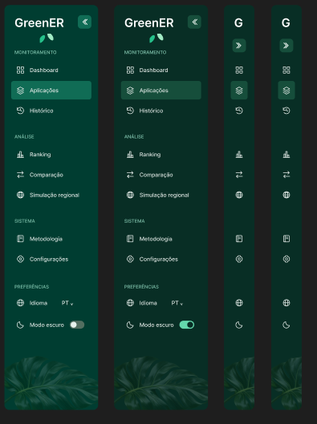
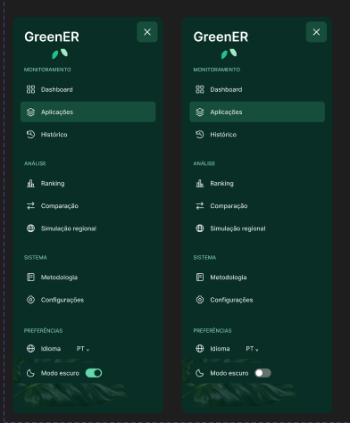

# EP00 — Protótipo da sidebar compartilhada e navegação responsiva

Registro de design relacionado à [issue #271](https://github.com/Seliganessecodigo/ABP-3DSM/issues/271), parte do [EP00 #99](https://github.com/Seliganessecodigo/ABP-3DSM/issues/99). A implementação da navegação pertence à [task de frontend #272](https://github.com/Seliganessecodigo/ABP-3DSM/issues/272).

## Protótipo de referência

[Abrir o arquivo GreenER no Figma](https://www.figma.com/design/bbt97My6jOZpJVYxbOc9T2/GreenER?node-id=0-1&p=f&t=gQPP7hhmNUF0A33e-0).

O autor informa que realizou a prototipação no Figma. Este registro descreve os elementos visíveis nas duas capturas fornecidas para revisão. O arquivo não pôde ser inspecionado pelas ferramentas desta sessão; ligações do protótipo, propriedades dos componentes e especificações internas ainda precisam ser conferidas pelo revisor no Figma.

## Composição apresentada

- Identidade GreenER no topo, com marca completa na sidebar expandida e marca reduzida nas versões recolhidas.
- Agrupamento dos destinos em **Monitoramento**, **Análise** e **Sistema**, além da seção **Preferências**.
- Ícones acompanhando os rótulos na versão expandida e apresentação por ícones na versão recolhida.
- Item **Aplicações** destacado nas variações apresentadas.
- Controles de idioma, com indicação **PT**, e de **Modo escuro**, com representações do interruptor ligado e desligado.
- Identidade visual em tons de verde e composição de folhagem na base da navegação.

### Destinos visíveis

| Grupo | Itens apresentados |
| --- | --- |
| Monitoramento | Dashboard, Aplicações e Histórico |
| Análise | Ranking, Comparação e Simulação regional |
| Sistema | Metodologia e Configurações |
| Preferências | Idioma e Modo escuro |

Esta lista registra os rótulos do protótipo. Ela não define rotas, disponibilidade funcional, associação definitiva a histórias ou política de permissões; essas decisões devem constar do handoff revisado.

## Evidências visuais

### Desktop — sidebar expandida e recolhida

A primeira captura apresenta quatro variações: duas expandidas e duas recolhidas. As expandidas exibem textos e agrupamentos; as recolhidas usam ícones e marca reduzida. Há controles visuais de recolhimento/expansão no topo.

### Mobile — painel com controle de fechamento

A segunda captura apresenta duas variações do painel com marca completa, ícones, rótulos e botão de fechamento no canto superior direito. O controle de modo escuro aparece nos dois estados. A captura isolada não demonstra sobreposição ao conteúdo nem comportamento durante redimensionamento.

## Conferência dos critérios da issue

| Critério | Evidência e limite desta revisão |
| --- | --- |
| Organização, rótulos, ícones e agrupamentos | Visíveis nas capturas; relação entre item, tela e US ainda precisa ser conferida no handoff. |
| Estados e identificação da área | Aplicações aparece destacada. Padrão, hover, foco, destino indisponível e associação de páginas de detalhe precisam de conferência no Figma. |
| Desktop e mobile | Variações expandidas/recolhidas e painel com botão de fechar estão representados. Medidas, abertura/fechamento, interação com conteúdo, transições e aprovação do recolhimento pelo PO precisam de conferência. |
| Acessibilidade | Há ícones e rótulos nas versões expandidas. Teclado, ordem/retorno de foco, Escape, nomes acessíveis, identificação do ativo além de cor e acesso aos itens recolhidos precisam ser validados. |
| Biblioteca, tokens, temas e idiomas | O controle de tema aparece ligado/desligado e o idioma está em PT. Vinculação a #260/#213, temas completos e textos longos nos oito idiomas precisam de conferência. |
| Reutilização e protótipo navegável | Conferir integração da mesma sidebar no dashboard, catálogo e detalhe e suas ligações no Figma. As capturas mostram o componente isolado. |
| Acesso público, configuração e destinos indisponíveis | A presença de Configurações não comprova autorização nem disponibilidade. Conferir regras aprovadas e registrar pendências no handoff, sem inferir permissões pelo visual. |
| Handoff e aceite do PO | Conferir mapa de destinos, medidas/tokens, regras de interação e pendências; registrar revisão e aceite na issue. Este registro não declara homologação. |

## Roteiro de revisão

1. Abrir o Figma e localizar os componentes e frames correspondentes às duas capturas.
2. Conferir estados, destinos e aplicação compartilhada em dashboard, catálogo e detalhe.
3. Exercitar navegação, recolhimento/expansão e abertura/fechamento mobile; conferir as regras documentadas de teclado, foco e Escape.
4. Conferir biblioteca/tokens, temas e acomodação de textos longos nos oito idiomas.
5. Registrar na issue #271 as decisões, pendências e o aceite do PO antes de considerar o handoff aprovado para #272.

## Verificações e limites

- Revisão visual baseada nas duas imagens fornecidas pelo autor no chat.
- Nenhuma alteração de código executável, rotas, APIs ou permissões faz parte desta entrega documental.
- Lint, build e testes de frontend/backend não foram executados: o escopo é o registro de design.
- `npm run docs:build` não se aplica a este arquivo: ele é uma evidência de PR em `.github/`, fora das páginas publicadas em `docs/`.
- A PR para `develop` deve atender aos checks obrigatórios do repositório, incluindo o **SonarQube Cloud quality gate**, conforme [quality-gates.md](../../quality-gates.md). Resultados devem ser conferidos na CI; este documento não declara aprovação.
- A issue permanece aberta até merge e confirmação do escopo entregue e do aceite correspondente.
