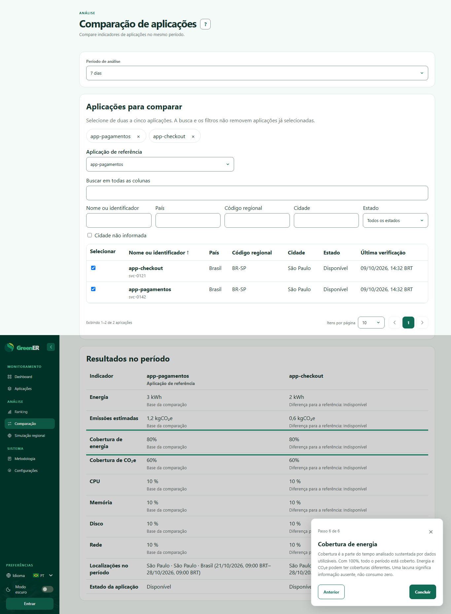
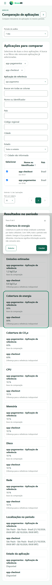
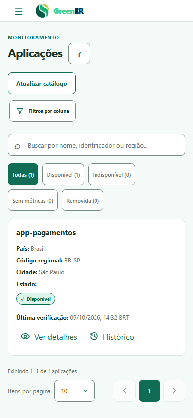
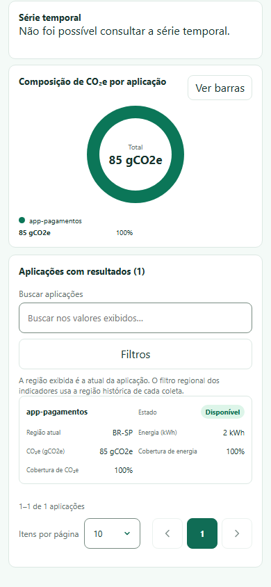

# Ajuda contextual e paginação

A ajuda explica energia e kWh, CO₂e, cobertura temporal, estados, período, métricas e fator regional. Os conceitos são compartilhados nos doze idiomas; cada tela define seus passos e alvos.

Na comparação, o tutorial explica seleção, período comum, aplicação de referência e leitura dos resultados. A referência é uma base de comparação, sem sugerir que seja a aplicação mais eficiente. Resultados ausentes mantêm a explicação acessível sem destacar outra área.

Catálogo, Dashboard, comparação, intervalos, contribuições e contas usam o mesmo componente de paginação. A página conserva seus filtros, seleção e consultas. Os botões têm altura de 36 px no desktop e 44 px no celular e usam o raio do projeto.

Os testes verificam os destaques de cada passo em detalhe, histórico e comparação; troca entre tabela e cards ao redimensionar; ausência de alvo antes de haver resultados; foco por teclado; traduções; paginação e filtros. A composição de CO₂e no Dashboard passa a destacar o gráfico correspondente, e a tabela de intervalos tem alvo próprio.
