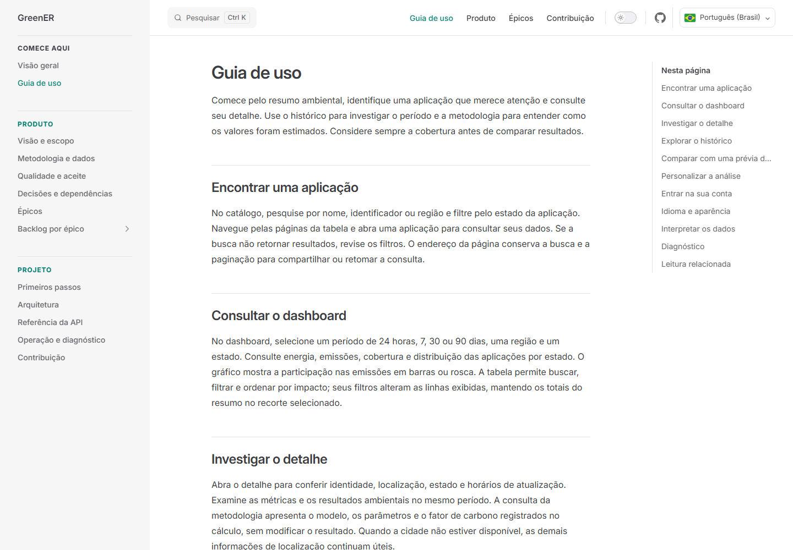
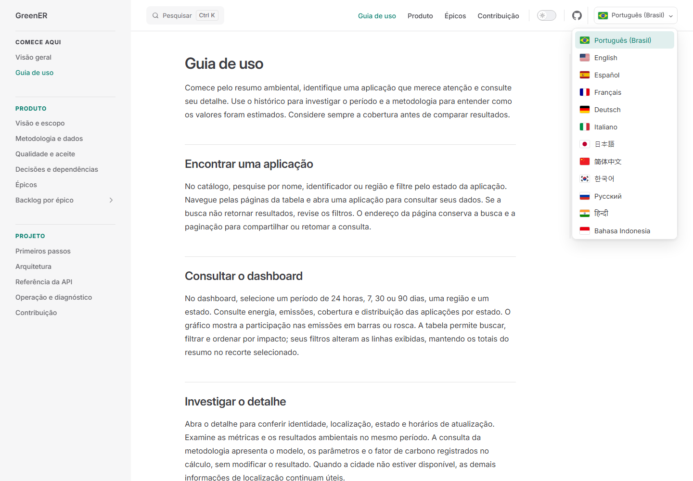
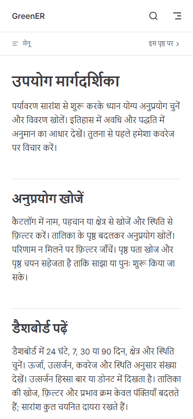

# Revisão editorial e equivalência dos idiomas

A revisão organiza a documentação por necessidade de leitura: conhecer o produto, realizar uma análise, interpretar resultados e consultar referências técnicas. As 19 páginas principais foram reescritas nos 12 idiomas com o mesmo conteúdo e a mesma estrutura.

## Alterações

- Guia de uso com orientações sobre catálogo, dashboard, detalhe, histórico, prévia, preferências e acesso; sem identificadores de implementação ou registros da sessão de edição.
- Visão de produto, metodologia, regras, critérios e épicos com escopo disponível e evoluções planejadas identificados. A exportação CSV permanece dependente de definição de escopo.
- Contratos, comandos e configuração concentrados nas páginas técnicas. Decisões de monitoramento, preservação do histórico e simulação regional foram mantidas.
- ADRs, especificações e protótipos continuam versionados no repositório, acessíveis pela arquitetura. Foram retirados do índice público, que agora publica somente o conjunto completo de páginas traduzidas.
- Seletor compacto com as 12 bandeiras em SVG, navegação por links e preservação da seção aberta ao mudar o idioma.
- Pesquisa, índice da página, controles de navegação, aparência e descrições localizados. Os rótulos dos estados foram conferidos com as traduções da aplicação.

## Verificações executadas

- `npm ci --prefix docs`: concluído, sem vulnerabilidades reportadas.
- `npm run docs:check`: 12 idiomas × 19 páginas; comparação de seções, parágrafos, tabelas, links, valores de contrato, exemplos técnicos e presença de bandeiras. Também verifica rótulos da interface e estados da aplicação.
- Teste de regressão do verificador: remoção temporária de uma seção em hindi foi rejeitada; após restauração, a conferência passou.
- `DOCS_BASE=/ABP-3DSM/ npm run docs:build`: concluído com verificação de equivalência e validação de links.
- Chromium/Playwright: 228 páginas com resposta 200, idioma e seções corretos; troca pelos 12 idiomas com bandeiras carregadas e controles traduzidos; preservação de `#history`.
- Teclado: abertura por Enter, acesso aos links por Tab, fechamento por Escape com retorno do foco e fechamento por clique externo.
- Celular: troca coreano → hindi e leitura sem overflow. Verificações de largura em 1440, 1280, 1024, 960, 768 e 390 pixels; navegações longas também conferidas em português, inglês, francês, alemão, russo e hindi.

O verificador automatiza equivalência estrutural e de contratos, sem substituir revisão linguística. As traduções foram revisadas em paralelo por assunto, sem avaliação independente por falantes nativos. As suítes da aplicação frontend/backend não foram repetidas porque esta mudança afeta o site documental. CI e SonarQube Cloud continuam necessários na PR. Não houve publicação manual do site.

As mensagens do tema usam as opções oficiais de [configuração do VitePress](https://vitepress.dev/reference/default-theme-config) e [pesquisa multilíngue](https://vitepress.dev/reference/default-theme-search). As bandeiras adicionais seguem a mesma biblioteca [flag-icons](https://github.com/lipis/flag-icons) e a licença MIT já presente em `docs/public/flags/LICENSE.txt`.

## Capturas

