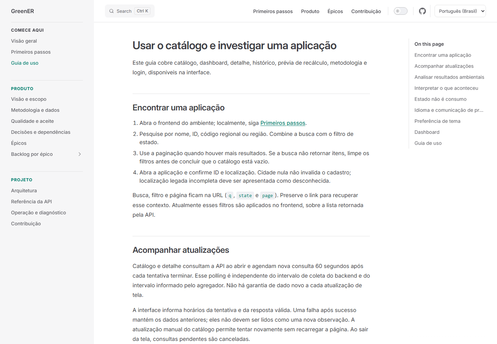
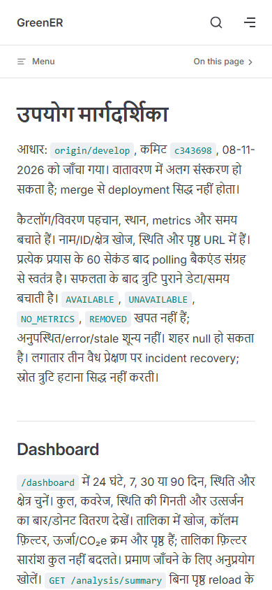

# Atualização da documentação e doze idiomas

Base conferida: `origin/develop` em `c343698`, em 08/11/2026.

Antes da revisão, o frontend já declarava doze locales em `frontend/src/i18n/types.ts`, mas o site publicava oito. A visão de produto e a referência HTTP ainda usavam `1633ca2` e descreviam dashboard, autorização e outras capacidades implementadas como pendências.

A revisão atualiza disponibilidade, navegação, histórico, prévia, preferências, autenticação, contas, auditoria e operação. Acrescenta `ko-KR`, `ru-RU`, `hi-IN` e `id-ID` à configuração, ao seletor e às dezenove páginas principais por idioma, incluindo os sete épicos. As decisões ainda pendentes permanecem explícitas. ADRs e evidências históricas foram preservadas.

## Verificações

- `npm ci --prefix docs`: instalação concluída, sem vulnerabilidades reportadas.
- `npm run docs:build`: build concluído com validação de links.
- Build adicional com `DOCS_BASE=/ABP-3DSM/`, correspondente ao GitHub Pages.
- Conferência por asserções da lista canônica do frontend: 12 idiomas × 19 páginas = 228 páginas existentes.
- Chromium/Playwright contra o HTML de produção: 12 opções no seletor, troca entre todos os idiomas mantendo `/reference/api.html` e o prefixo de publicação, atributo `lang` correspondente e rota de estado de conta presente em todas as versões.
- Viewports 1440 × 1000 e 390 × 844: seletor mobile com 12 opções, navegação coreano → hindi preservando a página e ausência de overflow horizontal e de erros JavaScript.

As capturas mostram o site local; não comprovam publicação em GitHub Pages nem revisão linguística por falantes nativos. Os testes de frontend/backend da aplicação não foram repetidos nesta alteração documental; a CI da PR e o gate SonarQube Cloud continuam obrigatórios.

## Capturas

