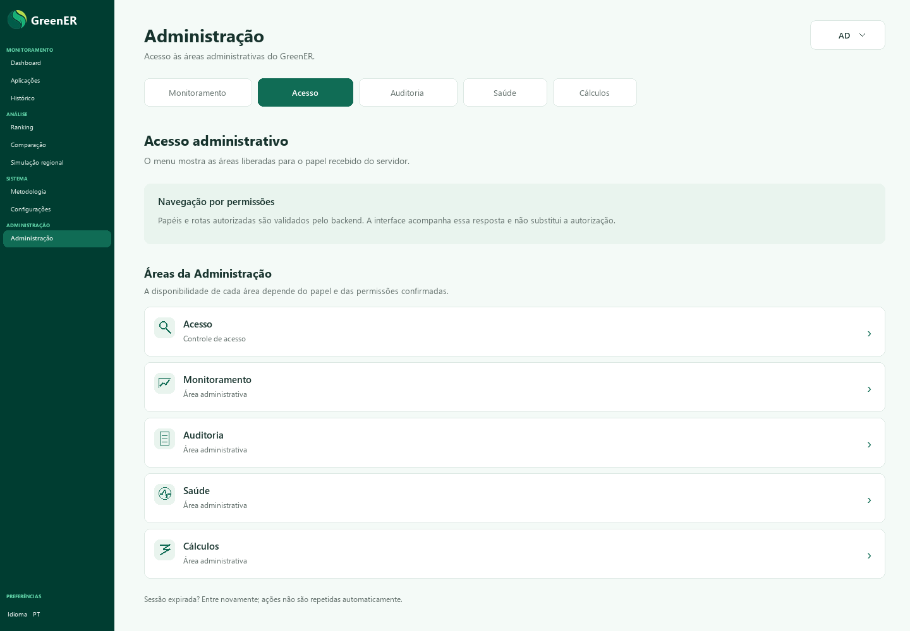
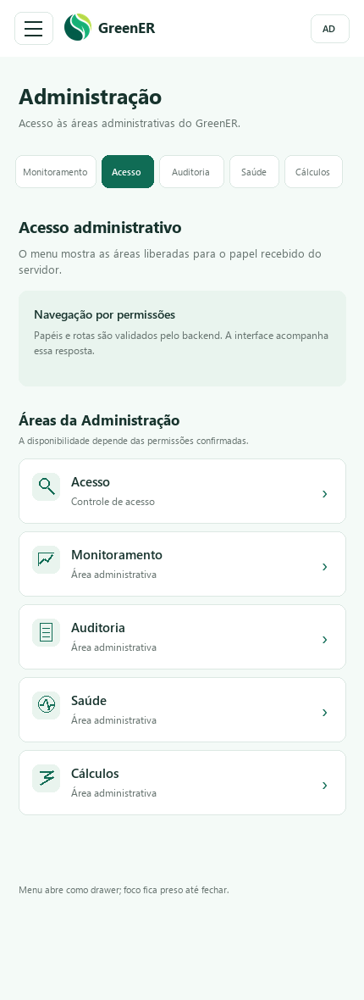

# Issue #256 — protótipo de login e navegação administrativa

Telas oficiais aprovadas para o fluxo responsivo da issue #256. O login acontece dentro da aba Administração, que permanece selecionada no menu. Após autenticar, o usuário chega ao hub administrativo mostrado abaixo.

## Primeira página após o login

| Desktop | Mobile |
| --- | --- |
|  |  |

## Marca-d’água

| Desktop | Mobile |
| --- | --- |
|  |  |

## Tema escuro

| Desktop | Mobile |
| --- | --- |
|  |  |

Estas seis imagens registram o protótipo aprovado para a [issue #256](https://github.com/Seliganessecodigo/ABP-3DSM/issues/256). O PR não implementa a autenticação nem redesenha as páginas internas do hub administrativo.
