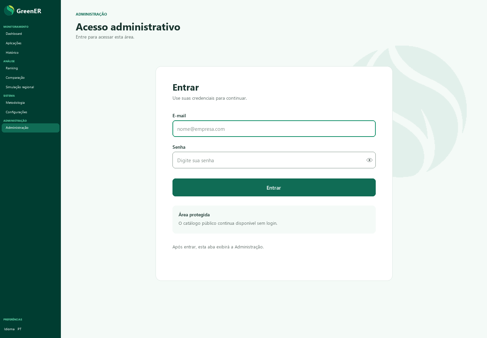
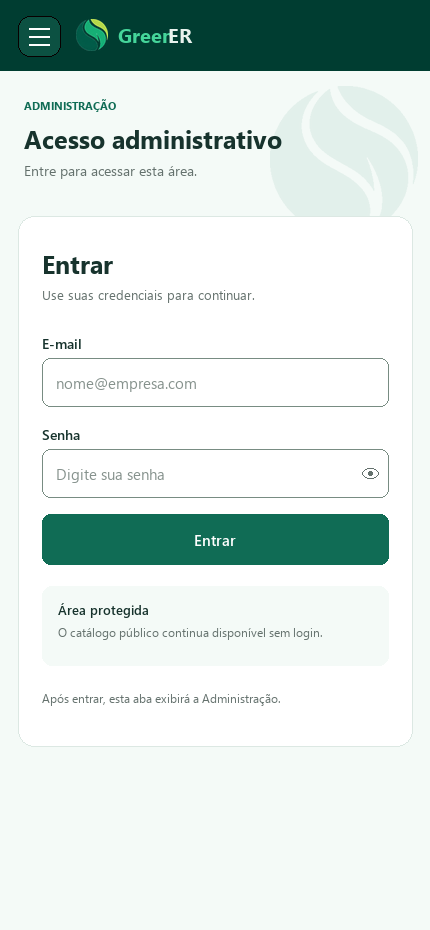
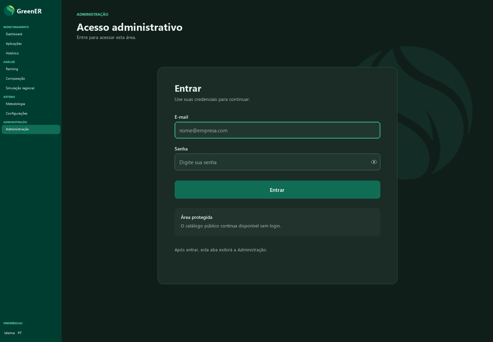
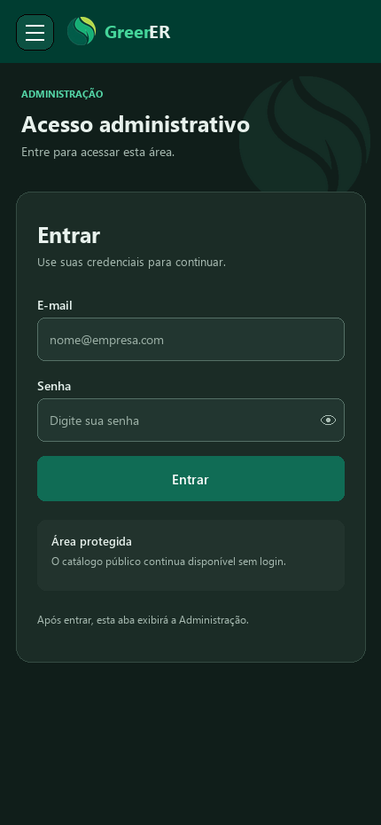

# Issue #256 — protótipo de login e navegação administrativa

Quatro telas oficiais aprovadas para o fluxo de login dentro da aba Administração. O item Administração continua selecionado no menu; após autenticar, o conteúdo da aba apresenta o hub administrativo.

## Marca-d’água

| Desktop | Mobile |
| --- | --- |
|  |  |

## Tema escuro

| Desktop | Mobile |
| --- | --- |
|  |  |

Estas imagens registram o protótipo aprovado para a [issue #256](https://github.com/Seliganessecodigo/ABP-3DSM/issues/256). O PR não implementa a autenticação nem redesenha as páginas internas do hub administrativo.
